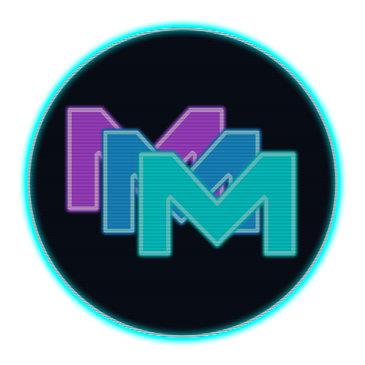

# 🌐 Marcelo Mercado (Mx3) — Portfolio & Engineering Hub

  

  <strong>Desarrollador de Software &middot; Full Stack &middot; IA Local &middot; Infraestructura IT</strong> 
  Buenos Aires, Argentina

  
  

---

## 🚀 Acerca de este Proyecto

Este repositorio contiene el código fuente de mi **Portfolio y Hub de Proyectos Profesional**, desarrollado bajo estándares de diseño moderno *Cyberpunk / High-Tech*, ultra liviano y optimizado para máxima velocidad de carga.

Desplegado y acelerado globalmente en **Cloudflare Pages** con CDN perimetral, SSL automático y 100% de disponibilidad.

### 🛠️ Tecnologías del Portfolio
* **Frontend:** HTML5 Semántico, CSS3 Puro (Variables CSS, Flexbox, CSS Grid, Efectos CRT Scanlines y Neón Glow).
* **JavaScript:** Vanilla ES6+ Modular (filtrado dinámico de proyectos, acordeones interactivos, renderizado reactivo sin frameworks pesados).
* **Despliegue & CI/CD:** Git + GitHub conectado a Cloudflare Pages con compilación y despliegue instantáneo en cada commit.

---

## 📂 Proyectos Destacados en el Portfolio

### 1. [Baity — Asistente Virtual Inteligente de Escritorio](https://github.com/Mrcx3/Baity-)
* **Categoría:** Software de Escritorio / IA Local
* **Stack:** Godot Engine 4.3 (GDScript), Python 3, Faster-Whisper, Piper TTS, Win32 API, GGUF Models.
* **Resumen:** Asistente inteligente para Windows con interfaz transparente interactiva, control total por voz, visión en pantalla y automatización de tareas del sistema operativo, funcionando 100% offline y privado.

### 2. Plataforma Web MVC & API RESTful (Baity)
* **Categoría:** Web Full Stack / API REST
* **Stack:** PHP 8.2, MySQL/MariaDB, Arquitectura MVC pura, PDO Prepared Statements, PHPMailer.
* **Resumen:** Plataforma web oficial para adopción de mascotas virtuales, tienda de skins y sincronización de perfiles en tiempo real consumida por la app Godot.

### 3. Mayorista ERP — Sistema de Gestión Comercial
* **Categoría:** Web Empresarial / Facturación
* **Stack:** PHP 8, MySQL, Nginx, Linux Ubuntu Server.
* **Resumen:** Sistema integral de control de stock multinivel, listas de precios diferenciadas, cuentas corrientes, ventas y facturación para empresas distribuidoras.

### 4. Local AI & RAG Orchestration Suite
* **Categoría:** Inteligencia Artificial / DevOps
* **Stack:** OpenWebUI, OpenCode, llama.cpp, Python, MCP (Model Context Protocol con Puppeteer).
* **Resumen:** Entorno privado y local para correr modelos masivos (Qwen 35B MoE) con RAG para documentos y scripts batch de auto-actualización y optimización de Windows.

---

## 📬 Contacto Profesional

* 🌐 **Portfolio en Vivo:** [https://marcelomercado.pages.dev](https://marcelomercado.pages.dev)
* 💼 **LinkedIn:** [linkedin.com/in/marcelo-mercado-mx3](https://www.linkedin.com/in/marcelo-mercado-mx3)
* 📧 **Correo Electrónico:** [marcelo.m95@hotmail.com](mailto:marcelo.m95@hotmail.com)
* 🐙 **GitHub:** [github.com/Mrcx3](https://github.com/Mrcx3)
